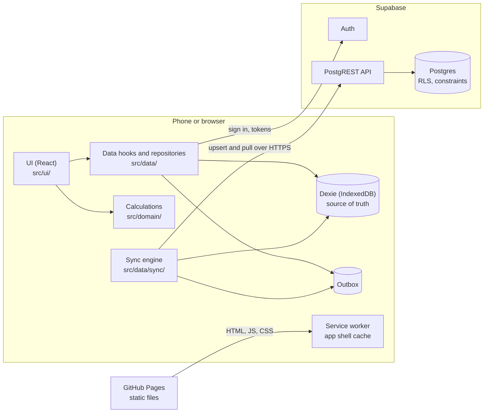
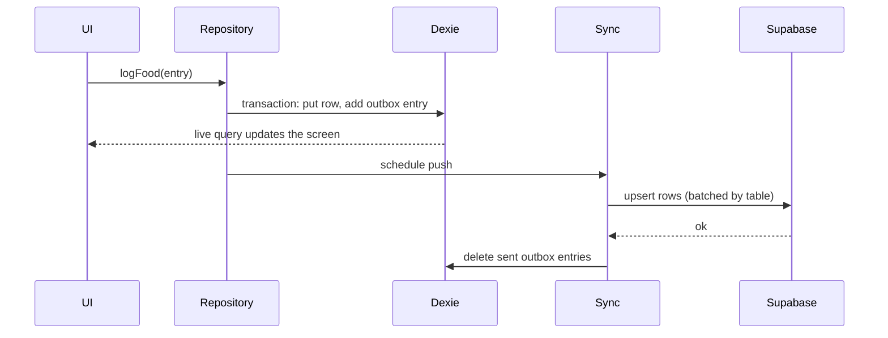

# Architecture

How Calorithm is built. `PLAN.md` says what the app does; this document says how. The reasons
for each choice are in [the decision records](decisions/).

## System overview

- **Screens never wait for the network.** They read Dexie through live queries, so they render
  instantly and refresh when a sync writes new rows.
- **Supabase stores the sync copy and enforces the rules.** Row-level security limits each row
  to its owner, and constraints reject bad values even from a modified client.
- **The service worker caches only the app shell.** All data lives in Dexie, so the app starts
  offline after the first load.

## Layers

| Layer | Folder | May import | Never imports |
|---|---|---|---|
| Domain | `src/domain/` | Other domain modules | React, Dexie, Supabase, browser APIs, the clock |
| Data | `src/data/` | Domain, Dexie, Supabase, Zod | UI |
| UI | `src/ui/` | Domain, data hooks, strings | Dexie tables, the Supabase client |

The `check-edit.sh` hook enforces the domain rule on every edit. The domain module can then
move unchanged into a Supabase Edge Function, a native app, or a reports job.

## Data model

`PLAN.md`, "Data model", lists the tables and the rules every table follows. Dexie mirrors the
Postgres tables with the same names and columns, plus two local-only tables:

| Local table | Holds |
|---|---|
| `outbox` | One row per pending write: table name, row ID, operation, payload, schema version, attempt count. |
| `sync_state` | Per table: the last pull position. Also the signed-in user ID and the last export date. |

Dexie's database name is `calorithm-<user_id>`. Signing out deletes it.

## Sync

### Writing

A repository function writes the row and its outbox entry in one Dexie transaction, so a crash
never leaves one without the other.

- **Idempotent:** every row has a device-created UUID, and the push is an upsert on that ID.
  A resend after a lost response writes the same row again.
- **Stamped:** the repository sets `client_updated_at` to the device's time and
  `schema_version` to the app's current shape. The server's trigger sets `updated_at`.
- **Order:** the outbox is sent in insertion order, parents before children (a recipe before
  its items).
- **Failures:** a network error leaves the entry for the next run, with exponential backoff. A
  rejection by a constraint or policy is permanent: the entry moves to a failed state, and the
  app shows it to the user instead of retrying forever.

### Pulling

For each table, the sync requests rows with `updated_at` later than the saved pull position
minus one minute, in pages ordered by `(updated_at, id)`. Each page continues after the last
`(updated_at, id)` pair it received, so rows sharing a timestamp across a page boundary aren't
skipped.

The overlap exists because the `updated_at` trigger stamps the transaction's start time. A
slow transaction can commit after a pull has already passed its timestamp, and without the
overlap that row is never pulled. Writes are idempotent, so rows fetched twice are
harmless.

### Conflicts

The most recent edit wins, compared as whole rows by `client_updated_at`.

- **On the server:** a `BEFORE UPDATE` trigger returns `NULL`, skipping the update, when the
  incoming `client_updated_at` is older than the stored one. Without it, an upsert overwrites
  unconditionally, and an old edit from a device that was offline beats a newer one.
- **On the device:** a pulled row doesn't overwrite a local row that still has an unsent
  outbox entry; the push settles it, and the next pull brings back the winner.
- `updated_at` isn't used for conflicts: it's server time, so it records when an edit
  synced, not when it was made.

Device clocks can be wrong. A device whose clock runs hours fast wins conflicts it shouldn't;
that's accepted for one user. With one user, conflicts need two devices editing the same row
while offline, which is rare. Per-field merging isn't worth its complexity until sharing
between users exists.

### Deletes

Deletes are soft: the row gets a `deleted_at` value and syncs like any other change. Screens
filter deleted rows out. A scheduled cleanup removes rows deleted more than 90 days ago.

A device whose last pull is older than 90 days may have missed a delete that the cleanup has
since erased. Before syncing, it pushes its outbox, clears its local tables, and pulls
everything.

### Signing out

Sign-out syncs first. If outbox entries remain, for example because the device is offline,
the app warns that those changes will be lost and offers an export. Then it deletes the local
database.

### When sync runs

On app start, when the connection returns (`online` event), when the app comes back to the
foreground (`visibilitychange`), and a few seconds after each local write. Only one sync runs
at a time.

### Schema versions

A phone can stay offline for weeks with outbox entries in an old shape. To stay compatible:

1. Each outbox entry records the `schema_version` it was written with.
2. A change clients see ships in two releases. The first adds the new columns, with defaults,
   and accepts both shapes. The second removes the old columns once no client sends the old
   shape.
3. The `app_config` table holds `min_app_version`. A client below it shows a required
   **Update** screen and stops syncing, so it can't send a shape the server no longer accepts.
4. Dexie's own schema version upgrades the local tables, with an upgrade test for each version.

## Authentication

- Email and password through Supabase Auth. The session lives in the app's storage, which an
  installed iOS app doesn't share with Safari, so magic links aren't used.
- The app uses only the publishable key (`sb_publishable_…`), which replaces the legacy anon key. Every request carries the user's token, and row-level
  security does the rest.
- Sign-ups are off in the dashboard while there's one user. `PLAN.md`, "Before friends join",
  replaces this with invite codes.

## Calculations

All in `src/domain/`, as pure functions:

| Module | Takes | Returns |
|---|---|---|
| `trend.ts` | Weigh-ins by date, a date range | Trend weight per day |
| `maintenance.ts` | Complete days' intake, trend weights, previous estimate, profile | New estimate, or a reason it was skipped |
| `targets.ts` | Maintenance, goal rate, trend weight, protein setting, calorie floor | kcal and protein targets, and any safety limit applied |
| `dates.ts` | Date strings | Calendar-day arithmetic, with no time zones |

The weekly check-in calls these with data from Dexie and today's local date, then stores the
inputs and outputs in `checkins`.

## Offline and updates

- `vite-plugin-pwa` precaches the built files. `registerType: 'prompt'` shows an
  **Update available** prompt instead of reloading on its own.
- On start, the app calls `navigator.storage.persist()` so the browser doesn't evict the local
  database.
- The app reads `min_app_version` on each sync and blocks syncing when it's too old.

## Hosting and environments

| Environment | Front end | Database |
|---|---|---|
| Local | `npm run dev` | Local Supabase in Docker |
| CI | Production build served by Playwright | Local Supabase in the CI runner |
| Production | GitHub Pages, `/calorithm/` base path, hash routes | Hosted Supabase free plan |

A staging Supabase project and a host that can send security headers come later. See the growth
checklists in `PLAN.md`.

## Failure modes

| Failure | Effect | Handling |
|---|---|---|
| No connection | Nothing visible | Writes queue in the outbox and sync later. |
| Supabase paused or down | Sync fails | The app keeps working; a quiet status shows the last sync time. |
| Constraint or policy rejects a write | One entry can't sync | Marked failed and shown to the user with the reason. |
| Local storage evicted | Local data lost | Pulled again from Supabase after sign-in; unsent writes are lost, which `storage.persist()` guards against. |
| Two devices edit one row offline | One edit lost | The later `client_updated_at` wins. |
| Device offline more than 90 days | Missed deletes | Full resync before the next sync. |
| Sign-out with unsent changes | Changes lost | Warning and an export offer first. |
| App too old | Sync stops | A required **Update** screen. |
