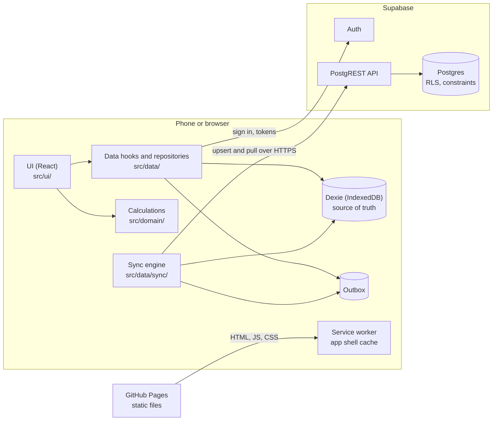
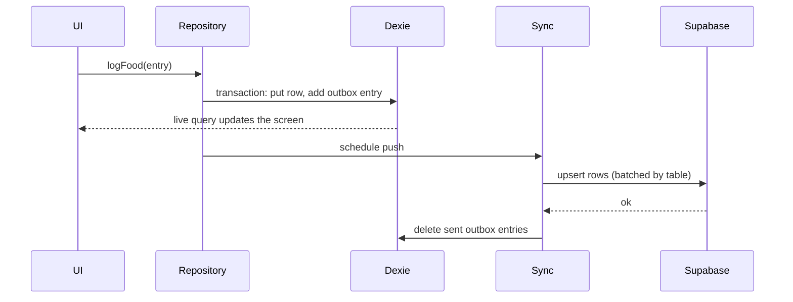

# Architecture

How Calorithm is built. `PLAN.md` says what the app does; this document says how. The reasons
for each choice are in [the decision records](decisions/).

## System overview

- **Screens never wait for the network.** They read Dexie through live queries, so they render
  instantly and refresh when a sync writes new rows.
- **Supabase stores the sync copy and enforces the rules.** Row-level security limits each row
  to its owner, and constraints reject bad values even from a modified client.
- **The service worker caches only the app shell.** All data lives in Dexie, so the app starts
  offline after the first load.

## Layers

| Layer | Folder | May import | Never imports |
|---|---|---|---|
| Domain | `src/domain/` | Other domain modules | React, Dexie, Supabase, browser APIs, the clock |
| Data | `src/data/` | Domain, Dexie, Supabase, Zod | UI |
| UI | `src/ui/` | Domain, data hooks, strings | Dexie tables, the Supabase client |

The `check-edit.sh` hook enforces the domain rule on every edit. The domain module can then
move unchanged into a Supabase Edge Function, a native app, or a reports job.

## Data model

`PLAN.md`, "Data model", lists the tables and the rules every table follows. Dexie mirrors the
Postgres tables with the same names and columns, plus three local-only tables:

| Local table | Holds |
|---|---|
| `outbox` | One row per pending write: table name, row ID, operation, payload, schema version, attempt count. |
| `sync_state` | Per table: the last pull position and the rows it couldn't read. |
| `meta` | This device's settings that never sync: the local day of its last export. |

Dexie's database name is `calorithm-<user_id>`. Signing out deletes it.

## Sync

### Writing

A repository function writes the row and its outbox entry in one Dexie transaction, so a crash
never leaves one without the other.

- **Idempotent:** every row has a device-created UUID, and the push is an upsert on that ID.
  A resend after a lost response writes the same row again. Tables with one row per user and
  date (`days`, `weights`, and `checkins`) derive the UUID from the user and date instead
  (`dayId`, `weightId`, and `checkinId` in `src/data/dayId.ts`), and a `CHECK` constraint
  requires it, so two devices write one row (decisions 0018 and 0020). Such a row's date never
  changes.
- **Stamped:** the repository sets `client_updated_at` to the device's time and
  `schema_version` to the app's current shape. The server's trigger sets `updated_at`.
- **Order:** the outbox is sent in insertion order, parents before children (a recipe before
  its items).
- **One entry per row:** repeat edits of a row collapse into one outbox entry holding the
  latest row. Each edit bumps the entry's `rev`, and a push deletes an entry only if its `rev`
  hasn't changed, so an edit made while a push is in flight is never lost.
- **Failures** (decision 0014):
  - A network error, a 5xx, or a 429 leaves the entries for later. Backoff is shared by the
    whole outbox, doubling up to 5 minutes with jitter, so a child row never goes ahead of a
    parent that's waiting.
  - An auth error asks the app to refresh the session, then retry at once, with no backoff.
  - A backoff time more than 5 minutes ahead comes from a clock that moved back, and counts
    as due.
  - A rejection by a constraint, policy, or foreign key is permanent. Postgres rejects a
    statement as a whole, so a rejected batch is resent one row at a time to find the bad
    rows. Those entries move to a failed state, and the app shows them to the user instead
    of retrying forever.
  - A row that references another, such as a log entry and its food, and fails on the
    foreign key while that parent has a failed change, stays queued instead of failing. It
    goes out once the parent is fixed or discarded (decision 0019).

### Pulling

For each table, the sync requests rows with `updated_at` later than the saved pull position
minus one minute, in pages ordered by `(updated_at, id)`. The saved position is the exact
`updated_at` string Postgres returned: JavaScript dates keep only milliseconds, and rounding
away the microseconds would skip rows (decision 0013).

- **Unreadable rows:** a row this app version can't parse, such as one written by a newer
  version, is recorded in `sync_state.unreadable`. The cursor moves past it, so each later
  pull fetches it again by id, and an upgraded app applies it.
- **Pull while waiting:** a pull runs even when the push is in backoff. It never replaces a
  row with a queued change, so other devices' changes keep arriving. Each page continues after the last
`(updated_at, id)` pair it received, so rows sharing a timestamp across a page boundary aren't
skipped.

The overlap exists because the `updated_at` trigger stamps the transaction's start time. A
slow transaction can commit after a pull has already passed its timestamp, and without the
overlap that row is never pulled. Writes are idempotent, so rows fetched twice are
harmless.

### Conflicts

The most recent edit wins, compared as whole rows by `client_updated_at`.

- **On the server:** a `BEFORE UPDATE` trigger returns `NULL`, skipping the update, when the
  incoming `client_updated_at` is older than the stored one. Without it, an upsert overwrites
  unconditionally, and an old edit from a device that was offline beats a newer one.
- **On the device:** a pulled row doesn't overwrite a local row that still has a queued or
  failed outbox entry. The upsert returns the rows the server stored, and push writes those
  copies locally. A row missing from that result was skipped as older; its `updated_at`
  didn't change, so no pull would ever fetch it again, and push fetches the server's copy
  by id instead.
- `updated_at` isn't used for conflicts: it's server time, so it records when an edit
  synced, not when it was made.

Device clocks can be wrong. A device whose clock runs hours fast wins conflicts it shouldn't;
that's accepted for one user. With one user, conflicts need two devices editing the same row
while offline, which is rare. Per-field merging isn't worth its complexity until sharing
between users exists.

### Deletes

Deletes are soft: the row gets a `deleted_at` value and syncs like any other change. Screens
filter deleted rows out. A scheduled cleanup removes rows deleted more than 90 days ago.

A device whose last pull is older than 90 days may have missed a delete that the cleanup has
since erased. It pushes its outbox, pulls every row, and then removes local rows the server no
longer has, except rows with an unsent change. Nothing is removed before the pull succeeds, so
an offline device never shows an empty app (decision 0015). The decision is made per table,
so a table added in a later version gets a full pull without re-reading the others.

Discarding a failed change fetches the server's copy of the row, or removes the row if it
never reached the server. It needs the network, because pulls skipped the row while its
change had failed.

### Signing out

`src/data/sync/session.ts` runs sign-out in this order:

1. Sync once more and wait for it to finish.
2. If outbox entries remain, including refused ones, show a warning with the count and three
   choices: **Export changes** (a JSON file of the unsent rows), **Sign out anyway**, and
   **Cancel**, which changes nothing and leaves sync running.
3. Stop the engine, close the database, record its name in `localStorage`, delete it, and
   clear the record.
4. Sign out of Supabase with `scope: 'local'`, which removes the session without the
   network.

The database goes first so an interrupted sign-out leaves the user signed in rather than
leaving data behind; on start, the app finishes any delete still recorded before it opens a
database (decision 0017). `DataProvider` shows the loading screen while deleting, so no
screen reads the database as it closes. Another tab with the database open closes it and
returns to sign-in.

### When sync runs

`src/data/sync/engine.ts` runs a sync on app start, when the connection returns (`online`
event), when the app comes back to the foreground (`visibilitychange`), and 3 seconds after
the last of a run of writes. Only one sync runs at a time; a request made during one runs once
more after it. Before each sync it reads `app_config.min_app_version`. An expired session is
refreshed once; if that fails, sync pauses and Settings asks the user to sign in again. After
a network failure it retries when the outbox's backoff ends, or after 30 seconds.

`src/data/sync/supabaseRemote.ts` is the only code that sends sync requests to Supabase. It
uses the client's untyped view, because the engine names tables at runtime; every row is still
checked by the table's Zod schema. It turns off the library's own read retries (decision
0016), and checks every cursor before it reaches a PostgREST filter.

### In the app

`src/data/DataProvider.tsx` opens the signed-in user's database and runs the engine. Screens
use its hooks (`useSyncStatus`, `useOutbox`, `useUnits`, `useSetUnits`, `useDiscard`) and the
food hooks in `src/data/foodHooks.ts`, and never see Dexie or the Supabase client. The header shows a sync badge when something needs
attention; Settings shows the last sync, changes waiting, and refused changes with
**Discard**.

### Schema versions

A phone can stay offline for weeks with outbox entries in an old shape. To stay compatible:

1. Each outbox entry records the `schema_version` it was written with.
2. A change clients see ships in two releases. The first adds the new columns, with defaults,
   and accepts both shapes. The second removes the old columns once no client sends the old
   shape.
   A nullable column a version adds is listed in its table's `addedColumns`; push never
   sends it as null, so a device that hasn't set it keeps the server's value (decision 0025).
3. The `app_config` table holds `min_app_version`. A client below it shows a required
   **Update** screen and stops syncing, so it can't send a shape the server no longer accepts.
4. Dexie's own schema version upgrades the local tables, with an upgrade test for each version.

## Authentication

- Email and password through Supabase Auth. The session lives in the app's storage, which an
  installed iOS app doesn't share with Safari, so magic links aren't used.
- The app uses only the publishable key (`sb_publishable_…`), which replaces the legacy anon key. Every request carries the user's token, and row-level
  security does the rest.
- Sign-ups are off in the dashboard while there's one user. `PLAN.md`, "Before friends join",
  replaces this with invite codes.
- **Delete account** on the settings screen signs in again with the password, then calls
  `public.delete_account()`. The function deletes the auth user, and every user table's
  `on delete cascade` removes the rows, only when the JWT's `amr` claim shows a password
  sign-in in the last 5 minutes (decision 0023). The app then deletes this device's database
  and session as sign-out does.

## Calculations

All in `src/domain/`, as pure functions:

| Module | Takes | Returns |
|---|---|---|
| `trend.ts` | Weigh-ins by date, a date range | Trend weight per day |
| `maintenance.ts` | Days' intake, weigh-ins, previous estimate, profile, today | New estimate, or a reason it was skipped or blocked |
| `targets.ts` | Maintenance, goal rate, trend weight, protein setting, calorie floor | kcal and protein targets, and any safety limit applied |
| `checkin.ts` | The above, the previous check-in, and the profile's settings | Whether a check-in is due, and the values to store |
| `dates.ts` | Date strings | Calendar-day arithmetic, with no time zones |

The check-in screen calls `runCheckin` with data from Dexie and today's local date, then stores
the result in `checkins` when you save it. Decision 0021 holds the rules.

## Export and import

`src/data/backup/` reads and writes the export file (decision 0022).

- **Export:** `buildExport` collects every live row on this device, including changes not
  yet sent, under a header with `format`, `version`, the export time, the app version, and the
  exporting account's `user_id`.
- **Checks:** `parseExport` refuses a file over 25 million characters, text that isn't JSON,
  another format, a newer version, or any row that wouldn't fit the database, before anything
  is written.
- **Import:** `importData` gives rows new ids when the file comes from another account, then
  writes each row newer than this device's copy, with its outbox entry, in one transaction.
  Rows keep the file's `client_updated_at`, so the server's trigger also keeps newer edits.
- **Screens:** **Your data** on the settings screen exports and imports, asking before an
  import with the file's export date and item count. The check-in screen shows a reminder once
  the last export from this device is more than 30 days old, or, on a device that never
  exported, once its oldest log entry or weigh-in is (`src/domain/backup.ts`).

## Offline and updates

- `vite-plugin-pwa` precaches the built files. With `registerType: 'prompt'`, a new
  deployment waits until the user selects **Update** on the **Update available** banner
  (`src/ui/UpdateBanner.tsx`); the app never reloads on its own.
- The service worker registers through `usePwaUpdate()` at the app root (`src/ui/pwa.ts`).
  Importing the plugin's React hook stops it injecting its own registration, so the hook must
  run on every screen.
- `usePwaUpdate()` asks for a new deployment hourly and whenever the app comes back to the
  foreground. It reads the registration's waiting worker itself, at start and after each
  check, because the plugin reports only an update its own tab found. Its `onNeedReload`
  turns off the plugin's reload when another tab's update takes control; the banner stays
  instead, and it also listens for the controller change any other tab's update causes.
  **Update** uses a worker that's already waiting, so it works offline. **Later** hides the
  banner for that version only: a newer deployment, or the next start, shows it again.
- On start, the app calls `navigator.storage.persist()` so the browser doesn't evict the local
  database.
- The app reads `min_app_version` on each sync and blocks syncing when it's too old.

## Hosting and environments

| Environment | Front end | Database |
|---|---|---|
| Local | `npm run dev` | Local Supabase in Docker |
| CI | Production build served by Playwright | Local Supabase in the CI runner |
| Production | GitHub Pages, `/calorithm/` base path, hash routes | Hosted Supabase free plan |

A staging Supabase project and a host that can send security headers come later. See the growth
checklists in `PLAN.md`.

## Failure modes

| Failure | Effect | Handling |
|---|---|---|
| No connection | Nothing visible | Writes queue in the outbox and sync later. |
| Supabase paused or down | Sync fails | The app keeps working; a quiet status shows the last sync time. |
| Constraint or policy rejects a write | One entry can't sync | Marked failed and shown to the user with the reason. |
| Local storage evicted | Local data lost | Pulled again from Supabase after sign-in; unsent writes are lost, which `storage.persist()` guards against. |
| Two devices edit one row offline | One edit lost | The later `client_updated_at` wins. |
| Device offline more than 90 days | Missed deletes | Full resync before the next sync. |
| Sign-out with unsent changes | Changes lost | Warning and an export offer first. |
| App too old | Sync stops | A required **Update** screen. |
